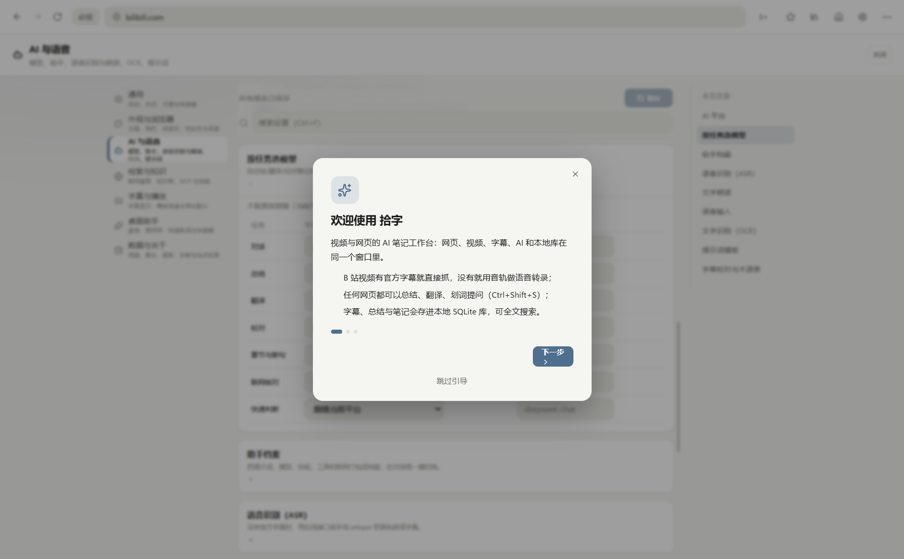
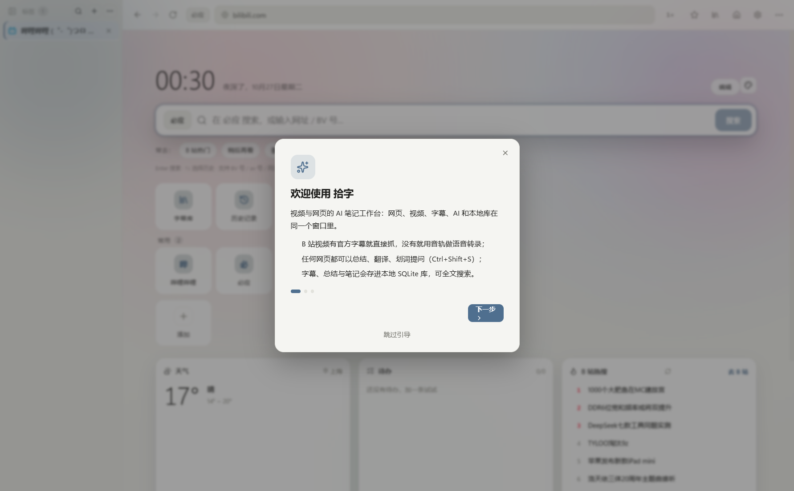
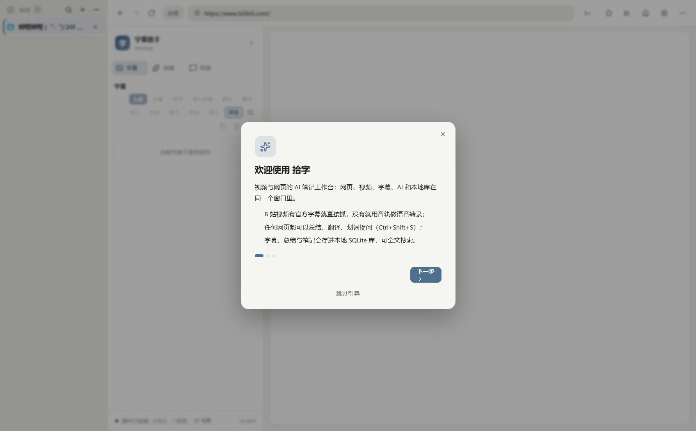

<div align="center">
  
  <p><b>B 站字幕 → 语音转录 → AI 笔记 → 跨视频知识库。</b></p>
  <p>浏览器插件 + Windows 桌面端，本地优先，数据留在自己电脑。</p>
</div>

<p align="center">
  <a href="https://github.com/Universe366/shizi/releases"></a>
  <a href="LICENSE"></a>
  
  
  
  
  
  
</p>

<p align="center">
  <a href="#为什么做这个">为什么</a> ·
  <a href="#功能">功能</a> ·
  <a href="#界面预览">界面</a> ·
  <a href="#快速开始">快速开始</a> ·
  <a href="#开发与测试">开发</a> ·
  <a href="#架构">架构</a> ·
  <a href="#隐私">隐私</a> ·
  <a href="https://github.com/Universe366/shizi/releases">下载</a>
</p>

> **非官方项目**，与哔哩哔哩无关联。自己的代码使用 MIT；内置 FFmpeg core 按 GPL 分发，见 [`THIRD_PARTY_NOTICES.md`](THIRD_PARTY_NOTICES.md)。

---

## 为什么做这个

B 站视频的字幕、音轨、评论和简介散在不同接口里，想整理成一份能用的笔记通常要来回切换工具。拾字把它们收进一个地方：

- 有官方字幕就直接抓，没有就**语音转录**；
- 转写完可以 AI 校对、翻译、分段、生成章节和总结；
- 总结、对话、笔记、字幕都进**本地库**，可以搜、可以问、可以导出；
- 需要外部信息时，联网结果只作为**可核对的补充**，不会把总结变成来源列表。

项目包含两个独立产品：

| 产品 | 目录 | 技术栈 |
|---|---|---|
| Windows 桌面端 | `desktop/` | Electron 45 + React 19 + TypeScript + SQLite |
| 浏览器插件 | `shizi-extension/` | Chrome / Edge MV3 + 原生 JS |

当前版本：**桌面 0.124.0 / 插件 2.18.8**。安装包与自动更新来自 [GitHub Releases](https://github.com/Universe366/shizi/releases)。

## 功能

### 字幕与播放

| 能力 | 说明 |
|---|---|
| 字幕抓取 | 只信 **WBI 签名接口** `/x/player/wbi/v2`；带时长、覆盖率、标题与视频身份校验，串视频时宁可显示无字幕 |
| 多语言字幕 | 多轨切换、原文 / 译文 / 双语三视图，翻译保留时间轴 |
| 跟随播放 | 逐句高亮、自动滚动；拖动进度条大跳转会重新定位 |
| 语音转录（ASR） | 没有官方字幕时：解析音轨 → 下载 → 解码 → 切片 → 识别；支持在线接口与**本地 whisper.cpp**（含模型一键下载） |
| 本地视频流水线 | 选择素材 → 生成字幕 → 整理字幕 → 出成片 → 成片记录，一条连续流程 |
| 官方分段 | B 站视频自带 `view_points` 时按官方分段组织总结与章节，不再让 AI 另造章节 |
| 校对与术语 | 本地规则 + AI 校对错别字/同音字/术语/数字，建议可勾选应用与回退 |
| 导出 | SRT / VTT / ASS / TXT / Markdown / JSON，6 格式 × 4 模板，支持双语 |

### AI 与对话

| 能力 | 说明 |
|---|---|
| 模型服务 | 40+ 平台预设，OpenAI 兼容 + **Anthropic / Gemini / Azure** 原生；模型列表拉取、多 Key 轮换、应用级代理 |
| 模型能力 | 自动识别文本 / 图片 / 音频，可手动开关；关闭图片后对话框与主进程都会拦截图片请求 |
| 按任务选模型 | 对话、总结、翻译、校对、章节、快速判断可分别指定平台与模型 |
| 助手档案 | 把「提示词 + 模型 + 技能 + MCP 工具 + 联网 + 温度/长度」存成档案，对话框一键切换 |
| 总结 | 流式 Markdown、思维链折叠、对话式联网工具循环、提示词/格式规则可编辑、官方分段优先、合集跨视频对比 |
| 对话 | 基于字幕/页面提问，流式、停止、图片、来源、token 估算、工具调用卡片 |
| 对话管理 | 独立 `chat.db`：历史会话、搜索、重命名、导出 Markdown、消息分支、编辑重发、重新生成、文本附件、引用提问 |
| 快捷指令 | 总结 / 待办 / 时间线 / 提问清单，一键用当前字幕或页面生成 |
| 多模型对比 | 选 2–3 个平台对同一问题并排回答，可复制或采用为回答 |
| 联网 | 默认 DeepSeek 官方搜索；支持 Tavily / 博查 / Serper / 智谱 / 秘塔 / 千帆 / Brave / Exa / Jina / SearXNG；可抓正文、设黑名单与结果截断 |
| 核对 | 总结前从字幕抽具体说法逐条检索，引用必须落在字幕；证据不足标注「未判定」 |
| MCP / 技能 | HTTP / SSE / **本地 stdio**；工具白名单、资源与提示词读取、**危险工具逐次审批**；SKILL.md 支持文件/文件夹/链接导入 |
| 用量 | 解析 OpenAI / Anthropic / Gemini usage，按模型/任务/日期统计，价格可改，CSV 导出 |

### 语音、OCR 与知识库

| 能力 | 说明 |
|---|---|
| 文字朗读 | Edge 在线 / Windows SAPI 离线 / OpenAI 兼容 TTS；朗读总结、回答、笔记，语速音量音色可调 |
| 语音输入 | 侧栏麦克风；全局听写热键，识别后写剪贴板并可自动粘贴到前台应用 |
| 本地 OCR | Windows 系统 OCR（离线），截图取字优先本地、失败回退 AI；可接自建 PaddleOCR 服务 |
| 跨视频知识库 | 字幕/总结/笔记切块 + embedding 索引，工作台「知识库」跨视频提问，回答带 `[n]` 引用并可跳转视频 |

### 浏览器与桌面

- 多标签内置浏览器、垂直标签栏、标签组、会话恢复、休眠、阅读模式、查找、收藏与历史。
- 地址栏搜索（B 站 / 必应 / Google / 自定义）、起始页快捷方式与壁纸。
- 网页倍速面板与快捷键、按站点记忆、画中画、弹幕与评论；地址栏紧凑 URL、11 个搜索引擎、书签建议、复制/粘贴/外部打开。
- 桌面宠物：拖拽/停靠/缩放、自由调整气泡宽高与字号、语音、截图标注、待办提醒、**任意应用快捷取词**。
- 快捷轮盘：全局热键呼出 8 方位轮盘，扇区可配置（总结/对话/工作台/设置等）；下载支持画质、仅音频、封面、字幕与元数据。
- 文件转换：工作台「文件转换」页支持拖入视频/音频/图片，环形格式选择，本机 ffmpeg 批量转换。
- 界面：浅色 / 深色 / 跟随系统，9 套配色（海盐蓝、松林绿、深海青、极光紫、玫瑰粉、樱花、琥珀、石墨、自定义），密度、字号、侧栏与标签栏可调。
- 全局截图、OCR 取字、AI 悬停球。

### 数据

- 本地 SQLite：`library.db`（字幕/总结/笔记/标签/合集）、`chat.db`（对话/工具调用）、`usage.db`（用量）。
- 笔记 Markdown + 历史版本；库内全文检索 FTS5。
- 一键备份/恢复（设置 + 字幕库 + 对话 + 用量），数据目录可迁移；卸载默认保留数据。

## 界面预览

<table>
  <tr>
    <td width="62%"></td>
    <td width="38%"></td>
  </tr>
  <tr>
    <td align="center">桌面端侧栏：字幕、总结、对话与库</td>
    <td align="center">设置页：7 个分类 + 每个分区一句话说明</td>
  </tr>
  <tr>
    <td></td>
    <td></td>
  </tr>
  <tr>
    <td align="center">起始页：快捷方式 / 热搜 / 天气</td>
    <td align="center">垂直标签栏：分组、搜索、预览</td>
  </tr>
</table>

扩展在 B 站视频页的形态：


## 快速开始

### 桌面端（推荐）

1. 从 [Releases](https://github.com/Universe366/shizi/releases) 下载 `shizi-setup-0.124.0.exe`（安装版）或 `shizi-0.124.0-win-x64-green.zip`（绿色版）。
2. 打开「设置 → AI 与语音」：选平台、填 Base URL、模型和 API Key，点「测试连接」。
3. 打开任意 B 站视频，左侧即可抓字幕、总结、对话；没有字幕就点「转写」。

> 安装包未签名，Windows SmartScreen 会提示；这是已知状态。

### 浏览器插件

1. 下载 `shizi-extension-v2.18.8.zip` 并解压。
2. Chrome / Edge 打开 `chrome://extensions`，开启「开发者模式」→「加载已解压的扩展程序」。
3. 打开 B 站视频页，右侧出现「拾字」面板；设置都在侧边栏内完成。

桌面端也可以直接在「设置 → 检索与知识 → 插件桥」里接收插件推送，并引导安装插件。

## 开发与测试

```bash
# 桌面端
cd desktop
npm ci
unset ELECTRON_RUN_AS_NODE   # Windows 本机若为 1，必须先清掉
npm run dev                  # Electron + Vite
npm run check                # typecheck + lint + 单测
npm run verify               # check + 真实 Electron 冒烟（19 条 E2E）
npm run pack                 # 构建 + 同步插件 + NSIS（不发布）

# 插件
cd verify
npm ci
node bundle.js
node panel-test.js           # 520 项
```

环境：Node 24.x（`node:sqlite` 需要 22+）；Node 版本不对会直接报错。

当前测试基线：**158 个测试文件 / 910 个用例**，冒烟 **E2E 19/19**，插件 **520 项**。

## 架构

```
desktop/
├─ src/main/        Electron 主进程：窗口/标签/桥/库/AI/ASR/OCR/TTS/MCP/知识库
├─ src/preload/     contextBridge API（window.bsub）
├─ src/renderer/    React 界面：Sidebar / Subtitles / Summary / Chat / Library / Settings
├─ src/shared/      跨进程类型、品牌、预设、纯函数
├─ scripts/         构建、同步、发布、冒烟；mocks/ 下为本地 AI/ASR/MCP mock
└─ docs/            架构、桥协议、平台说明、加固记录
```

- `main` 不 import `renderer`；渲染层只能通过 `preload` 暴露的 `window.bsub` 调主进程。
- 新增 IPC 放 `src/main/ipc/<domain>.ts`，`ipc.ts` 只保留注册入口。
- 数据库改动走 `src/main/migrations.ts`，用 `PRAGMA user_version` 顺序迁移。
- 字幕只信 WBI 签名接口，详细原因见 [`desktop/docs/ARCHITECTURE.md`](desktop/docs/ARCHITECTURE.md)。

更多文档：

| 想知道 | 读 |
|---|---|
| AI / 维护者接手 | [`AGENTS.md`](AGENTS.md)、[`HANDOFF.md`](HANDOFF.md) |
| 桌面端分层与坑 | [`desktop/docs/ARCHITECTURE.md`](desktop/docs/ARCHITECTURE.md) |
| 设置页 / 对话输入区怎么改 | [`docs/UI-GUIDE.md`](docs/UI-GUIDE.md) |
| 数据库表、迁移与备份 | [`docs/DATA-MODEL.md`](docs/DATA-MODEL.md) |
| 插件 ↔ 桌面通信 | [`desktop/docs/BRIDGE.md`](desktop/docs/BRIDGE.md) |
| 发布 / 签名 / 更新 | [`docs/MAINTAINERS.md`](docs/MAINTAINERS.md) |
| 质量基线与重构顺序 | [`docs/QUALITY.md`](docs/QUALITY.md) |

## 隐私

- API Key 用 Windows DPAPI 加密后保存在本机，**不上传**；备份和诊断导出会清空 Key。
- 字幕、总结、对话、笔记、用量全部在本机 SQLite，默认不联网同步。
- 只有你主动触发总结/对话/检索/embedding 时，才会把相应文本发给你配置的服务商。
- 网页文本一律按**不可信资料**处理，不执行页面里的指令。

## 版本

- 桌面端：**0.124.0**（2026-10-29）
- 插件：**2.18.8**
- 变更记录：[`desktop/CHANGELOG.md`](desktop/CHANGELOG.md)、[`shizi-extension/CHANGELOG.md`](shizi-extension/CHANGELOG.md)

## License

自有代码 MIT，见 [`LICENSE`](LICENSE)。FFmpeg.wasm 等第三方组件按各自许可证分发，见 [`THIRD_PARTY_NOTICES.md`](THIRD_PARTY_NOTICES.md)。