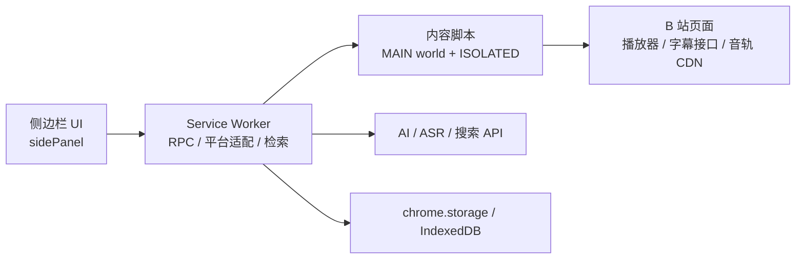

<div align="center">
  
  <p><b>浏览器扩展 + Windows 桌面端：抓字幕、语音转录、AI 总结、导出与本地字幕库。</b></p>
</div>

<p align="center">
  <a href="https://github.com/Universe366/shizi/releases"></a>
  <a href="LICENSE"></a>
  
  
  
  
  
</p>

<p align="center">
  <a href="#快速开始">快速开始</a> ·
  <a href="#界面预览">界面预览</a> ·
  <a href="#功能">功能</a> ·
  <a href="#架构">架构</a> ·
  <a href="#开发与测试">开发与测试</a> ·
  <a href="#文档">文档</a> ·
  <a href="https://github.com/Universe366/shizi/releases">下载</a>
</p>

> Chrome / Edge MV3 扩展 · 所有配置在侧边栏内完成 · 无 Obsidian 集成 · API Key 只保存在本机
>
> **非官方项目**，与哔哩哔哩无关联。自己的代码使用 MIT；内置 FFmpeg core 按 GPL 分发，见 [`THIRD-PARTY-NOTICES.md`](shizi-extension/THIRD-PARTY-NOTICES.md)。

---

## 仓库结构

| 目录 | 内容 |
|---|---|
| `shizi-extension/` | Chrome / Edge MV3 插件：内容脚本、侧边栏、后台检索、转录 |
| `desktop/` | Windows 桌面端（Electron + React + SQLite），含 TS 源码、脚本与文档 |
| `verify/` | 插件测试套件（node + 真实浏览器），不属于扩展运行时 |
| `docs/` | 维护文档：仓库地图、质量基线、发布与签名 |
| `HANDOFF.md` / `AGENTS.md` | 当前状态与接手约束，**改代码前先读** |

构建产物（`desktop/release`、`desktop/out`、`resources/extension`）不入库，用 `npm run pack` 重新生成。

## 界面预览

<table>
  <tr>
    <td width="62%"></td>
    <td width="38%"></td>
  </tr>
  <tr>
    <td align="center">视频页右侧直接内嵌，不遮挡评论区；可折叠为「字幕」标签</td>
    <td align="center">设置、Key、提示词与页面内功能都在侧边栏完成</td>
  </tr>
</table>

> 截图来自真实扩展在 B 站视频页的运行效果；不同 B 站版本/窗口宽度下布局会略有差异。

## 为什么用它

B 站视频的字幕、音轨、评论和简介散在不同接口里，想整理成一份可用的笔记通常要来回切换工具。这个扩展把它们收进一个侧边栏：

- 有官方字幕就直接抓，没有就语音转录；
- 转写完可以 AI 校对、总结、分段、生成章节；
- 想导出 SRT、Markdown 或学习笔记，一键完成；
- 需要外部信息时，联网结果只作为**补充提醒**，不会把总结变成一份来源列表。

## 功能

| 能力 | 说明 |
|---|---|
| **页面内嵌面板** | 默认在视频页右侧直接显示；Shadow DOM 隔离，不干扰 B 站评论区；可折叠、关闭、Alt+Shift+B 全局开关。 |
| **字幕抓取** | 优先请求 **WBI 签名接口** `/x/player/wbi/v2`，只信签名结果；签名失败才回退到播放器/嗅探。带时长、覆盖率、标题内容与缓存签名校验，避免串分 P、串视频。 |
| **多语言与翻译** | 同一视频有多条官方字幕轨时可切换语言；支持 AI 翻译为常用/自定义目标语言，保留时间轴。 |
| **跟随播放** | 字幕逐句高亮、自动滚动；拖动进度条大跳转时恢复到对应句。 |
| **语音转录** | 没有官方字幕时：解析音轨 → 分块下载 → 解码 → 16 kHz 单声道 → 重叠切片 → 逐片识别 → 去重合并；支持 FFmpeg 流复制重封装、并发与随时终止。 |
| **AI 总结** | 流式 Markdown、思维链独立折叠、长视频分段总结再合并；生成前可先联网校对字幕。 |
| **AI 对话** | 基于当前视频字幕提问，流式输出，支持 MCP 工具与 Skills。 |
| **联网补充** | 默认 DeepSeek 官方搜索（复用 AI Key）；也支持 Tavily / 博查 / Serper / 智谱 / 秘塔 / 百度千帆 / Brave / Exa / Jina / SearXNG；无 Key 时自动落到免费引擎。 |
| **校对与替换** | AI 修正错别字 / 同音字 / 术语 / 数字 / 时间；规则组、术语表、一键应用与回退。 |
| **导出** | SRT / WebVTT / ASS / TXT / Markdown / JSON，6 种格式 × 4 种模板。 |
| **批量与历史** | 批量队列、章节、质量自检、历史记录、操作留痕。 |

## 桌面端（Windows）

除了浏览器扩展，仓库里还有一个 Windows 桌面端 `desktop/`：把 B 站浏览器、字幕、AI 和本地库放进同一个程序，适合不想开浏览器扩展、或需要本地库/批量处理的场景。

<p align="center">
  
</p>
<p align="center"><sub>桌面端侧栏：空库状态（0 个视频，无测试/历史数据）</sub></p>

- 内置 B 站浏览器（多标签、登录、播放、弹幕、评论），扩展里的字幕/总结/翻译/优化/章节/ASR/MCP/Skills 都有对应原生入口
- 本地 SQLite 库：条目详情、字幕/总结/笔记、标签与合集、全局搜索、批量总结、合集/多 P 整包导入
- 总结与笔记保留历史版本；合集可生成跨视频对比，支持导出与搜索命中
- 字幕诊断、质量检查、6 种导出格式、自动更新、托盘、标签休眠
- 任务抽屉统一管理任务与导出记录；长任务可暂停/取消/重试失败项，完成时发系统通知
- 字幕只信 WBI 签名接口；自动选轨做时长/覆盖率/标题校验，串视频时宁可显示无字幕
- ASR 与翻译结果按视频/轨缓存，刷新面板不会丢
- 总结核对、GFM 表格、64k 输出、字幕身份校验与行内编辑
- 数据备份/恢复：设置 + 字幕库一键备份，恢复前自动保留当前数据
- 数据位置迁移：复制到新目录并自动重启，成功后删除旧目录
- 侧栏可拖拽调宽、折叠成图标栏、左右换边；安装时可输入新父目录，卸载时可选择是否删除本地数据（含自定义位置）

源码版本见 [`desktop/package.json`](desktop/package.json)（当前 **0.38.19**）。下载前以最新 Release 资产和 [`desktop/CHANGELOG.md`](desktop/CHANGELOG.md) 为准；如果检查更新显示“已是最新”，先确认 Release 里的桌面版本。

安装版直接运行 `shizi-setup-*.exe`，绿色版解压后双击 `拾字.exe`。数据默认在 `%APPDATA%\shizi`（设置、字幕库、登录态、缓存、日志；旧版 `bsub-desktop` 首次启动自动迁移）；可在设置里迁移到其他目录，迁移成功后旧目录会自动删除。卸载页默认保留数据，勾选后才会删除（包括自定义位置）。

开发与打包：

```bash
cd desktop
npm install
unset ELECTRON_RUN_AS_NODE   # Windows 本机若设置过，必须清掉
npm run dev                  # Electron + Vite
npm run typecheck
npm run dist                 # NSIS 安装包 + 绿色 zip + latest.yml
```

详见 [`desktop/README.md`](desktop/README.md)、[`desktop/docs/ARCHITECTURE.md`](desktop/docs/ARCHITECTURE.md)、[`desktop/docs/PARITY.md`](desktop/docs/PARITY.md)、[`desktop/docs/PLATFORMS.md`](desktop/docs/PLATFORMS.md)。

## 快速开始

1. 从 **[Releases](https://github.com/Universe366/shizi/releases)** 下载最新 zip，解压。
2. 打开 `chrome://extensions`（Edge 为 `edge://extensions`）→ 开启「开发者模式」→「加载已解压的扩展程序」。
3. 选择解压后的 **`shizi-extension/`** 目录（包含 `manifest.json` 的那一层，不是仓库根目录）。
4. 打开任意 B 站视频页：右侧会自动出现内嵌面板；也可以点工具栏图标打开浏览器侧边栏（两者可切换）。

首次使用可以只抓官方字幕，不需要任何 Key。要用 AI 总结 / 转录 / 联网时，再去 **设置** 里填对应平台的 Key。

> 当前通过 GitHub Releases 分发；Edge 商店提交材料已准备（见 `docs/EDGE-STORE.md`），上架后可由商店自动更新。手动更新后请在扩展页点刷新，并**刷新所有已打开的 B 站页面**。

## 架构



- **主环境桥**负责读取页面里的播放器状态、字幕接口和音轨字节（Referer 必须由页面发出）。
- **Service Worker** 负责 RPC、平台调用、重试与错误翻译；service worker 与面板是两份独立代码。
- **侧边栏**只做 UI 与业务编排，所有配置都在这里完成。
- **桌面端**（`desktop/`）是独立的 Electron 程序：主进程用 `WebContentsView` 承载 B 站页面、CDP 注入同一份 `page-bridge.js`；渲染进程是 React 侧栏 + 浏览器区域；字幕/总结/设置存在本地 SQLite 与 `settings.json`。

## 适合谁

- 想把 B 站课程、访谈、技术分享整理成笔记 / 字幕文件的人；
- 需要批量处理多个视频、或视频没有官方字幕的人；
- 愿意自己填 AI / ASR Key，换更可控的总结与转录。

**不适合**：想要完全零配置、或需要“自动上传 / 自动发布”的场景。

## 开发与测试

```bash
cd verify
npm install
npm test                    # 21 个 node 套件
npm run test:browser        # 4 个真实浏览器套件（需要 Chrome/Edge）
npm run test:browser:smoke  # 10 项真实扩展冒烟（内嵌面板 / 评论区 / 侧边栏 / 设置页）
```

当前 **21 个 node 套件、1468 项断言**全部通过；真实扩展冒烟需要本地 Edge/Chrome 与网络，未在 CI 中运行。

桌面端：

```bash
cd desktop
npm install
unset ELECTRON_RUN_AS_NODE     # Windows 本机若设置过必须清掉
npm run check                  # typecheck + lint + 单测
npm run verify                 # check + 真实 Electron 冒烟（E2E）
npm run dev                    # 开发模式
npm run pack                   # 打包 NSIS 安装包（不发布）
```

详见 [`desktop/README.md`](desktop/README.md)。

## 文档

| 文件 | 内容 |
|---|---|
| [`AGENTS.md`](AGENTS.md) | 给下一个 AI/维护者：边界、命令、禁止事项 |
| [`HANDOFF.md`](HANDOFF.md) | 当前状态、已知风险、接手任务菜单 |
| [`docs/REPO-MAP.md`](docs/REPO-MAP.md) | **先看这个**：目录结构、文档选择、维护规则 |
| [`docs/QUALITY.md`](docs/QUALITY.md) | 质量基线、技术债与重构顺序 |
| [`验收清单.md`](验收清单.md) | 发版后按功能逐条验收的清单模板 |
| [`shizi-extension/README.md`](shizi-extension/README.md) | 用户文档：安装、配置、功能、故障排查 |
| [`CONTRIBUTING.md`](CONTRIBUTING.md) | 怎么跑测试、怎么提 PR |
| [`desktop/README.md`](desktop/README.md) | 桌面端安装、开发、打包、数据与卸载 |
| [`desktop/docs/README.md`](desktop/docs/README.md) | 桌面端文档索引（当前 / 历史） |
| [`desktop/docs/ARCHITECTURE.md`](desktop/docs/ARCHITECTURE.md) | 桌面端模块、数据流、字幕/数据目录/安装器维护笔记 |
| [`desktop/docs/HARDENING.md`](desktop/docs/HARDENING.md) | 0.34–0.37 加固、迁移与冒烟验收 |
| [`desktop/docs/BRIDGE.md`](desktop/docs/BRIDGE.md) | 插件 ↔ 桌面本地桥协议 |
| [`desktop/docs/REBRAND.md`](desktop/docs/REBRAND.md) | bsub-desktop → shizi 品牌/路径迁移记录 |
| [`desktop/docs/PARITY.md`](desktop/docs/PARITY.md) | 桌面端 vs 插件功能矩阵与验收 |
| [`desktop/docs/PLATFORMS.md`](desktop/docs/PLATFORMS.md) | 桌面端 AI / 检索 / ASR 平台目录 |
| [`desktop/docs/archive/REAL-REGRESSION.md`](desktop/docs/archive/REAL-REGRESSION.md) | 0.30.x 真实平台回归（历史） |
| [`docs/MAINTAINERS.md`](docs/MAINTAINERS.md) | 发布清单、桌面端构建/更新/卸载、易踩坑与商店提交注意事项 |
| [`SECURITY.md`](SECURITY.md) | 安全问题与密钥泄露的处理方式 |
| [`docs/SIGNING.md`](docs/SIGNING.md) | Windows 代码签名、CI Secrets 与验证 |
| [`LICENSE`](LICENSE) | MIT（本项目代码） |
| [`shizi-extension/THIRD-PARTY-NOTICES.md`](shizi-extension/THIRD-PARTY-NOTICES.md) | FFmpeg.wasm 等第三方组件许可证 |
| [`shizi-extension/CHANGELOG.md`](shizi-extension/CHANGELOG.md) | 按版本汇总的新增 / 修复 / 清理 |
| [`shizi-extension/AGENTS.md`](shizi-extension/AGENTS.md) | 给 AI / 贡献者：环境硬约束、踩坑、排查方法论 |
| [`shizi-extension/docs/history/DEVELOPMENT-LOG.md`](shizi-extension/docs/history/DEVELOPMENT-LOG.md) | 逐轮缺陷与修复复盘（开发记录，不是使用文档） |
| [`PRIVACY.md`](PRIVACY.md) | 隐私政策 |
| [`shizi-extension/docs/EDGE-STORE.md`](shizi-extension/docs/EDGE-STORE.md) | Edge 商店包、文案、权限理由、素材与认证备注 |
| [`verify/README.md`](verify/README.md) | 测试套件说明与运行方式 |

## 说明

- 桌面端数据默认在 `%APPDATA%\shizi`（旧版自动迁移）；卸载页默认保留，勾选后才删除。绿色版没有卸载器，退出后删除程序目录，需要彻底清理时再手动删数据目录。
- 桌面端自动更新只对**安装版**有效，并且要求最新 Release 带 `latest.yml`；绿色版请手动替换。如果检查更新显示“已是最新”，先确认最新 Release 的桌面资产和 `latest.yml` 是否已更新。
- 扩展的 API Key 只保存在 `chrome.storage.local`，不同步到其他设备，也不会上传。
- MCP 只支持远程 `http` / `sse`；浏览器扩展无法启动本地进程，因此不支持 `stdio`。
- 非 M4A 平台的语音转录会把音频解码进侧边栏内存，长视频转录时请保持侧边栏打开。
- DeepSeek 官方搜索按**成功请求**计费（$0.75 / 1000 次），可在设置中换回免费引擎。
- 内嵌面板依赖 B 站右侧栏 DOM；B 站改版或窄窗口下可能退回浏览器侧边栏，可在「设置 → 页面内功能」关闭内嵌。
- 字幕采用**严格归属校验**：无法证明属于当前视频的播放器/嗅探轨会被丢弃。若视频明明有字幕却显示为空，先看「字幕候选轨明细」里的「被排除的跨视频字幕轨」，再刷新页面重试。
- AI 翻译会覆盖当前显示文本，但每行 `original` 保留原文；切换回原语言轨可重新抓取。
- 真实浏览器冒烟测试需要本地 Edge/Chrome 与网络，不在 CI 中运行；Node 套件可在无浏览器环境跑。

## 作者的话

> 此插件是本人 vibe coding 作品，有 bug 不代表本人能修；本人是新手，请各位大佬高抬贵手。遇到问题欢迎提 Issue，但请温柔一点 🙏

## License

本项目代码使用 [MIT](LICENSE)。内置 FFmpeg core 为 GPL-2.0-or-later 构建，详见 [`THIRD-PARTY-NOTICES.md`](shizi-extension/THIRD-PARTY-NOTICES.md)。

---

<p align="center">
  <sub>如果这个项目对你有帮助，欢迎 Star 或提 Issue。</sub>
</p>
